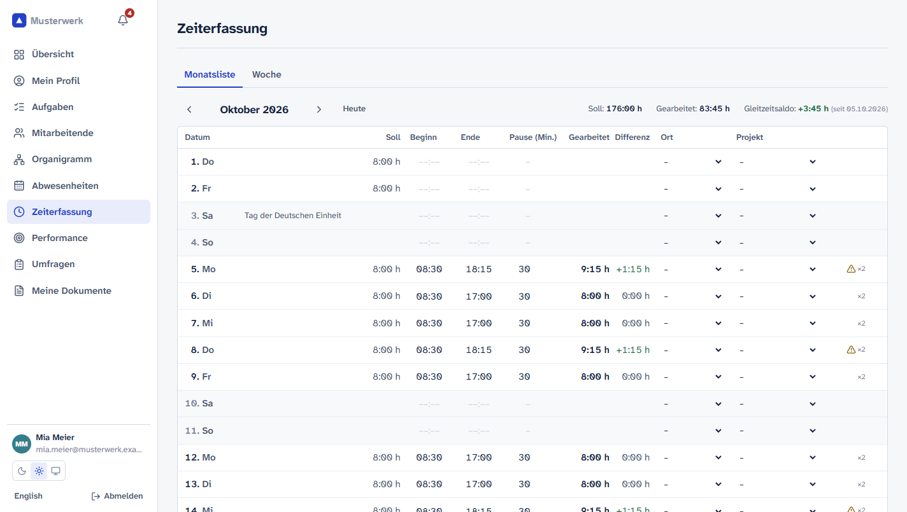
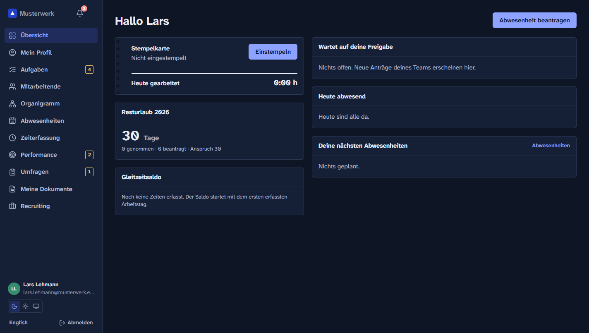
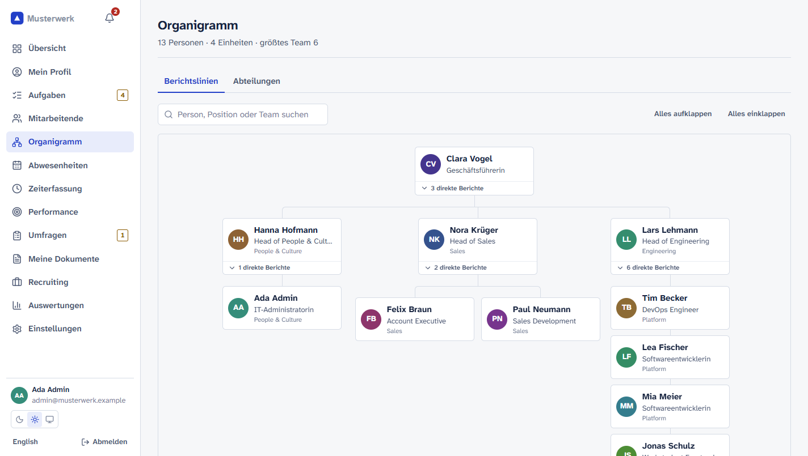
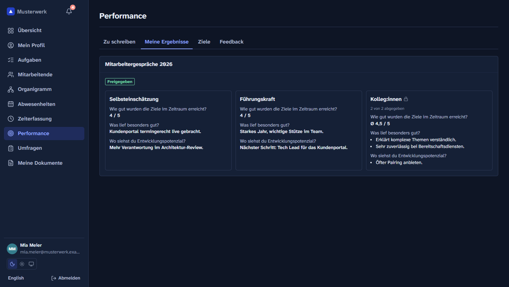
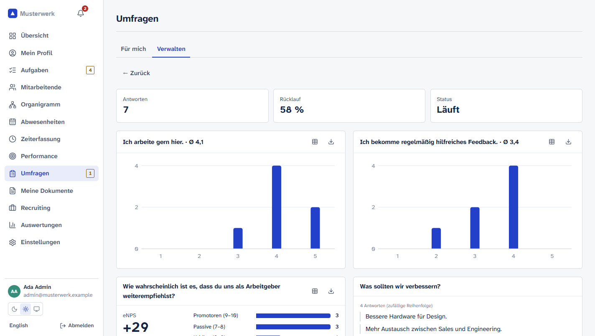

# OpenPers

**Open-source HR software you host yourself.** For small and mid-sized companies in Germany, Austria
and Switzerland: employee records, absences, time tracking, documents, recruiting, onboarding,
performance reviews and employee surveys – in one application under your own control.

[](https://github.com/<owner>/openpers/actions/workflows/ci.yml)
[](LICENSE)

> 🇩🇪 Deutsch weiter unten · German version below



<table>
  <tr>
    <td></td>
    <td></td>
  </tr>
  <tr>
    <td></td>
    <td></td>
  </tr>
</table>

<sub>Screenshots show the demo company from `npm run seed:demo` – all people are fictional.</sub>

## Features

| Area | What it does |
|---|---|
| **Employee records** | People with employments over time, org chart (reporting lines and departments), working-time models per weekday, scheduled changes, custom fields, profile photos, personal profile page (`/me`), company directory |
| **Access to sensitive data** | Roles with scopes (everyone / department / team / self) and a per-role access matrix over 7 data categories (basic data, contact, personal, employment, compensation, bank & tax, performance); confidential fields encrypted with AES-256-GCM |
| **Absences** | Absence types, vacation policies with carry-over and expiry, pro-rata entitlement (BUrlG §5), public holidays of all 16 German states plus AT/CH, half days, approvals, team calendar |
| **Time tracking** | Clock in/out, month list with inline editing, breaks, projects, German Working Hours Act checks (breaks, 10 h, rest), flextime balance, team overview, approval and locking |
| **Documents** | Per-person documents with categories and employee visibility, file signature checks, templates with placeholders |
| **Recruiting** | Jobs, pipeline, public careers page with your logo, applications with CV upload, ratings, "hire" creates the employee, automatic anonymization after the retention period |
| **On-/offboarding** | Checklist templates with due dates relative to start/exit, assignment to HR/manager/employee, task inbox, notifications |
| **Performance** | Review cycles with self, manager and anonymous peer reviews (shown in aggregate from 2 peers), release to the employee, goals with progress, praise and confidential feedback |
| **Surveys** | Anonymous surveys (answers stored without user or time), templates (engagement pulse, eNPS, onboarding), results only from 3 answers, eNPS, department heatmap, reminders |
| **Analytics** | Headcount, hires and exits, turnover, tenure, absence rates – with table view, CSV export and small-group suppression |
| **Platform** | Dark and light mode, German & English UI, company logo, audit log, GDPR export & anonymization, REST API with OpenAPI, API tokens, signed webhooks |

## Quick start (Docker)

```bash
git clone https://github.com/<owner>/openpers.git && cd openpers
cp .env.example .env
# set SECRET_KEY (openssl rand -hex 32) and POSTGRES_PASSWORD;
# optional OPENPERS_IMAGE=ghcr.io/<owner>/openpers:latest to skip the local build
docker compose up -d
```

Open http://localhost:3000. The setup wizard creates your company and the first administrator.

For production (HTTPS, backups, updates) read **[docs/self-hosting.md](docs/self-hosting.md)**.

## Without Docker

Node.js 22+. Without `DATABASE_URL`, an embedded PostgreSQL (PGlite) in `DATA_DIR` is used – good for
evaluation and small teams; use a real PostgreSQL in production.

```bash
npm ci && npm run build
cp .env.example .env   # set SECRET_KEY
npm start
```

Demo data for a fresh installation: `DEMO_PASSWORD=choose-a-password npm run seed:demo`.

## Development

```bash
npm ci
cp .env.example .env        # set SECRET_KEY
npm run dev:server          # API on :3000 (auto-reload)
npm run dev:web             # UI on :5173, proxies /api to :3000
npm test                    # domain + API tests (embedded DB, no Docker needed)
```

```
packages/shared   domain logic (holidays, absences, balances, ArbZG, permissions, analytics, surveys)
apps/server       Fastify API, one folder per module in src/modules/*, Drizzle ORM + migrations
apps/web          React UI (Vite, React Router, TanStack Query, Tailwind, i18next)
```

See [CONTRIBUTING.md](CONTRIBUTING.md) for conventions and the release process. API documentation:
`GET /api/v1/openapi.json`. Security reports: [SECURITY.md](SECURITY.md).

## Legal

OpenPers is an independent project and not affiliated with Personio or any other vendor. The feature
scope was derived from public documentation; no third-party code or design was used. Notes on
statutory rules (BUrlG, ArbZG, GDPR) are support features, not legal advice.

Licensed under the [GNU Affero General Public License v3.0 only](LICENSE) – see [NOTICE](NOTICE).

---

## 🇩🇪 Deutsch

**Quelloffene Personalsoftware zum Selbst-Hosten** für kleine und mittlere Unternehmen im DACH-Raum:
Personalakte, Abwesenheiten, Zeiterfassung, Dokumente, Recruiting, On-/Offboarding,
Mitarbeitergespräche und anonyme Umfragen.

**Schnellstart:** `.env.example` nach `.env` kopieren, `SECRET_KEY` (`openssl rand -hex 32`) und
`POSTGRES_PASSWORD` setzen, `docker compose up -d`, dann http://localhost:3000 öffnen. Der
Einrichtungsassistent legt Firma und erstes Admin-Konto an. Betrieb mit HTTPS, Sicherung und Updates:
[docs/self-hosting.md](docs/self-hosting.md).

**Highlights für DACH:** Feiertage aller 16 Bundesländer sowie AT/CH, anteiliger Urlaubsanspruch nach
BUrlG §5, Resturlaub mit Verfall, ArbZG-Hinweise, Zugriffsmatrix für sensible Daten, verschlüsselte
Gehalts- und Bankdaten, DSGVO-Export und Anonymisierung, Löschfristen für Bewerbungen, anonyme
Umfragen mit Mindestgruppengröße, Oberfläche auf Deutsch und Englisch.

**Sicherung:** Datenbank **und** `DATA_DIR/files` sichern, ebenso den `SECRET_KEY`.

**Mitmachen:** [CONTRIBUTING.md](CONTRIBUTING.md) · Sicherheitslücken bitte vertraulich melden:
[SECURITY.md](SECURITY.md) · Lizenz: AGPL-3.0.
